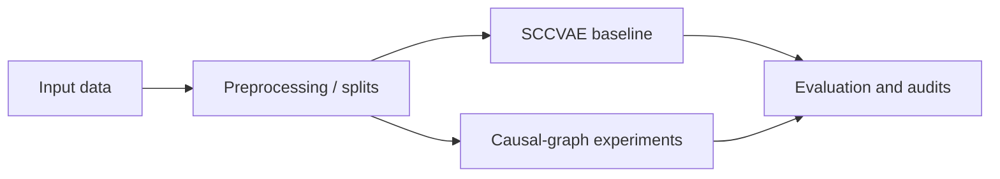

# CausalGraphs

**An experimental workspace for causal-graph discovery, intervention-oriented modeling and reproducible baseline comparisons.**

The repository brings together an existing SCCVAE codebase, baseline run tooling, data preparation, evaluation utilities, and separate experiments around causal graph construction. It is a research workbench rather than a packaged, ready-to-deploy library.

> **Research attribution:** `sc_causal/` contains upstream SCCVAE-related research code and utilities. Do **not** interpret that code, the upstream model design, or upstream figures as original contributions by this repository's maintainer. The repository's experiment organization and locally added workflows should be distinguished from upstream work and traced to their corresponding source or documentation.

## Workspace at a glance

| Directory | Purpose |
| --- | --- |
| `sc_causal/` | Original / upstream research implementation and utilities |
| `scripts/setup/` | Environment setup and dependency checks |
| `scripts/baseline/` | Baseline launch, evaluation and audit scripts |
| `scripts/data/` | Resumable dataset preparation and validation |
| `scripts/causal/` | Causal discovery and bounded benchmark utilities |
| `configs/` | Experiment configuration references |
| `experiments/` | Baseline index, future experiments and implementation notes |
| `docs/` | Upstream and project-specific documentation |

## Experimental workflow



The diagram is a conceptual map and does not imply that all planned GNN experiments are implemented.

## Setup

The existing setup is documented for **Windows, Python 3.12 and CUDA 12.4**. Read [`docs/UPSTREAM_README.md`](docs/UPSTREAM_README.md) for the upstream instructions and the [archived project notes](docs/research-workspace-notes.md) for the prior README's paths, warnings and experiment-specific run instructions.

```powershell
python -m venv .venv
python -m pip install -r requirements.txt
python scripts/setup/verify_setup.py
```

Check any PowerShell setup launcher or project-specific dependency list before invoking training.

## Reproducibility and claim boundaries

- Historical baseline checkpoints, local datasets, generated graphs and run outputs may be stored only in ignored local directories; a repository clone alone is not a full reproduction.
- The original project notes state that certain preprocessing is transductive and that learned-shift and test-selected results must remain separate. Respect those distinctions in any reported comparison.
- GNN preparation scripts and causal-discovery benchmarks do not automatically prove a trained or validated GNN system exists.
- Large causal searches and fresh training are **manual operations**, not setup checks; avoid triggering them unintentionally.

See [`experiments/baseline/`](experiments/baseline/), [`experiments/future/`](experiments/future/), and the [archived detailed README](docs/research-workspace-notes.md) before running experiments.

## Presenting this work

Useful contributions to highlight include the independently implemented experiment orchestration, validation and comparison protocols **where substantiated by the corresponding source code**. For any published result, name the upstream baseline, dataset split, protocol and evaluation limitations rather than making broad causal or state-of-the-art claims.

---

**Maintainer:** [Alihassan0155](https://github.com/Alihassan0155) · [Portfolio](https://ali-hassan-khan-portfolio.vercel.app/)
